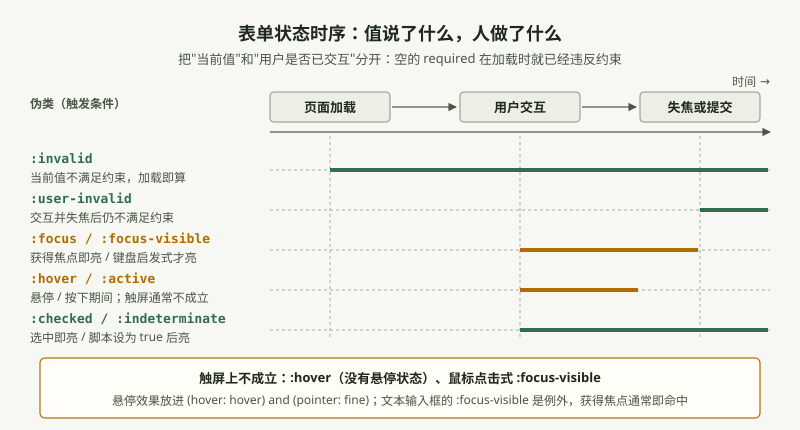

# 24 · 表单控件与状态

> **前置**：[02](02-selectors.md)——伪类与属性选择器；[16](16-pseudo-elements.md)——`:checked` 联动；[23](23-accessibility.md)——label 与焦点。
>
> 上一篇：[23](23-accessibility.md) ｜ 下一篇：[表格、列表与计数](25-tables-lists.md) ｜ [教程总览](README.md)

```css
input[type="checkbox"] { accent-color: #3f6b2a; }
```

一行让所有勾选框换成品牌绿。表单控件是 CSS 里最特殊的一族：**外观来自浏览器原生绘制，样式权是"有限放开"的**。这一章讲清放权层次、状态伪类的时序记忆法、结构关联，以及 iOS 16px 缩放这类移动端专属事故。

## 放权层次：appearance 与三件免改品

| 层次 | 手段 | 代价 |
| --- | --- | --- |
| 原生换肤 | **`accent-color`**（勾选/单选/进度/滑块）、`::placeholder`、`caret-color` | 零代价，首选 |
| 放权微调 | **`appearance: none`** + 自绘边框/背景/箭头 | 丢失部分原生行为，自己补 |
| 完全自绘 | 自绘控件 + JS 状态 | 键盘/读屏全部自担，组件库级别 |

放权后可正常改 `font/color/background/border/padding/border-radius`；`select` 自定义箭头就是 `appearance: none` + 背景图。代价要清楚：**原生行为细节（下拉键盘导航、日历面板）是浏览器资产，放权越多自担越多**。

## 状态伪类：按"时序"记



*图 24-1 · 表单状态时序：值说了什么，人做了什么*

**这张图的一句话结论：`valid/invalid` 只看值，`user-invalid` 要等用户碰过——报错时机由这条线决定。**

| 阶段 | 伪类 | 要点 |
| --- | --- | --- |
| 值的状态 | `:valid` `:invalid` | 只看值，**页面加载即判定** |
| 交互后 | `:user-invalid` `:user-valid` | 非法**且用户碰过**才命中——报错不吓人 |
| 占位中 | `:placeholder-shown` | 尚未输入 |
| 可用性 | `:enabled` `:disabled` `:read-only` `:read-write` | 注意 `disabled` vs `readonly` 的语义差 |
| 选中 | `:checked` `:indeterminate` | 勾选与半选（复选"全选框"） |

**`disabled` vs `readonly`**：disabled 不可交互、**不参与提交**、读屏跳过；readonly 可聚焦可选中文本、值照常提交——"展示一个不可改的值"用 readonly，"整个控件不可用"才 disabled。

## 状态联动配方

```css
/* ① 纯 CSS 开关 */
.switch input { position: absolute; opacity: 0; }
.switch input:checked + .track { background: var(--brand); }
.switch input:checked + .track::before { translate: 20px 0; }
.switch input:focus-visible + .track { outline: 2px solid var(--amber); }  /* 别丢焦点态 */

/* ② :has() 让父级感知 */
.field:has(input:user-invalid) label { color: crimson; }
.field:focus-within { border-color: var(--brand); }

/* ③ fieldset 级联禁用 */
fieldset[disabled] { opacity: .6; }   /* 整组控件自动禁用，无需逐个加 */
```

配方 ① 三个细节：input 绝对定位隐身（不能用 `display: none`——会失去键盘可达性）；**焦点环必须补回**（自绘后 `:focus-visible` 打在 input 上，用兄弟选择器画到 track 上）；`translate` 动画走合成（第 13 篇）。配方 ③ 是隐藏福利：`fieldset[disabled]` 一次性禁用整组。

## 移动端与各端差异

- **iOS 16px 缩放坑**：输入框字号小于 16px 时，iOS 聚焦输入会**自动放大页面**。修法：表单控件字号 ≥ 16px（或 `<meta viewport maximum-scale=1`，但它伤害无障碍，不推荐）。
- **date/color/file 各端绘制差异大**：`file` 的通用自绘配方是"隐藏原生 input（保持可达）+ label 当按钮"；`date` 面板样式基本不可控，能改的只有外壳。
- **`select` 的 option** 各端样式权极有限，深度定制换组件库或 `<datalist>`。
- `textarea { resize: vertical; }`（只许纵向拉伸）是通用体验细节。

## 常见问题

**问题 1：页面一加载，必填框全红**
- **原因**：`:invalid` 只看值，空必填框加载即命中。
- **修法**：报错样式改 `:user-invalid`；旧引擎用 JS"碰过才加类"兜底。

**问题 2：自绘开关后键盘用户"看不见焦点"**
- **原因**：`appearance: none` 顺手把焦点视觉也丢了（焦点还在，只是看不见）。
- **修法**：`input:focus-visible + .track` 画焦点环（配方 ① 第三行），绝不能省。

**问题 3：placeholder 当 label，输入后提示消失**
- **原因**：placeholder 是"示例"不是"标签"，且对比度常不达标（第 23 篇）。
- **修法**：永远用真 `<label for>`；placeholder 只放格式示例。

**问题 4：iOS 上点输入框页面突然放大**
- **原因**：字号 < 16px 触发自动缩放（本节移动端差异）。
- **修法**：控件字号统一 ≥ 16px；用 rem 保证随全局缩放。

**问题 5：`select` 展开面板样式改不动**
- **原因**：下拉面板由操作系统绘制，CSS 权限极小。
- **修法**：接受原生面板（多数场景是对的）；需要完全定制时换 headless 组件 + 保持 ARIA。

## 动手验证

[打开 demo：表单控件样式与 accent-color](../../examples/minimal/20-forms.html)

<iframe class="demo-frame" src="/css-concept-course/examples/minimal/20-forms.html" title="表单样式实验" loading="lazy"></iframe>

[打开实验台：表单状态时序实操](../../examples/forms/form-states.html)

时序实验台"没填就失焦"再"填错再失焦"，对比两种伪类亮灯时机；demo 里换 accent-color 一键换装，再用 Tab 检验自绘开关的焦点环。

## 本章要点

- 放权三层次：accent-color > appearance 微调 > 完全自绘；越放权越自担。
- 状态按时序记：**`:user-invalid` 是报错样式的正确选择**；disabled 不提交、readonly 提交。
- 自绘开关三件不能省：隐身 input 保留可达、`:focus-visible` 焦点环、合成动画位移。
- `fieldset[disabled]` 级联禁用整组。
- 移动端：控件字号 ≥ 16px 防 iOS 自动缩放；file 自绘走"label + 隐身 input"。

下一篇 [25 · 表格、列表与计数](25-tables-lists.md)：边框模型、列宽算法与 sticky 表头的边框消失之谜。
