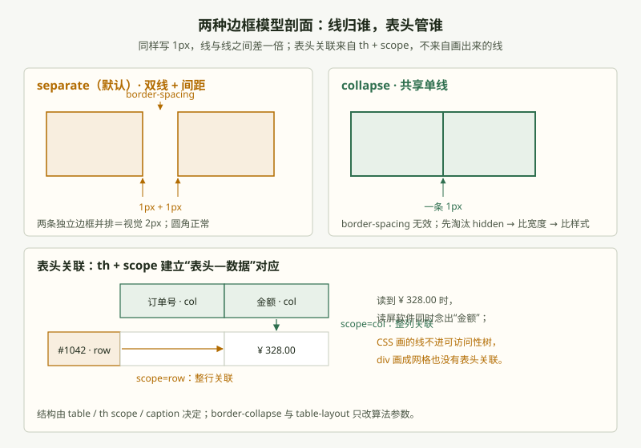

# 25 · 表格、列表与计数

> **前置**：[02](02-selectors.md)——`:nth-child` 与 counter；[09](09-position.md)——sticky；[17](17-overflow-scroll.md)——滚动容器。
>
> 上一篇：[24](24-forms.md) ｜ 下一篇：[现代平台特性](26-modern-platform.md) ｜ [教程总览](README.md)

```css
table { border-collapse: collapse; }
thead th { position: sticky; top: 0; }
```

吸顶表头写完，滚动起来**表头的边框消失了**——这两个特性单看都对，放一起就出事。表格的分工体系：**行列语义来自 HTML，CSS 只管边框合并、列宽与外观**。这一章讲全两种边框模型、列宽算法、结构化样式，以及 sticky 表头与 collapse 的经典冲突。

## 边框模型：collapse vs separate



*图 25-1 · collapse 合并相邻边框；separate 各画各的，间隙归 border-spacing*

**这张图的一句话结论：collapse 把相邻边框"合成一条"（宽者胜）；separate 各画各的，格间空隙由 border-spacing 管。**

| 模型 | 行为 | 适用 |
| --- | --- | --- |
| `collapse` | 相邻单元格边框合并，冲突按"宽度大 > 样式重 > 来源方向"裁决 | **默认选择**，数据表 |
| `separate` | 各画各的，`border-spacing` 控制间隙 | 卡片化表格、圆角单元格 |

collapse 的合并规则解释了一个现象：**相邻单元格各写 1px 边框不会变成 2px**（合并取一条）。想均匀边框，统一写在 `td` 上即可。

## 列宽：两种算法的工程取舍

| 算法 | 列宽怎么定 | 特点 |
| --- | --- | --- |
| `auto`（默认） | 扫全表内容取最大宽度再分 | 内容一多一少列宽就歪；**全表算完才渲染** |
| `fixed` | 只看第一行/显式宽度，内容按 overflow 处理 | **列宽确定、渲染快** |

数据表的工程答案：`table-layout: fixed` + 显式列宽 + 单元格省略（第 07 篇三件套）。`table` 是少数"宽度默认撑满父容器"的块级盒（`width: auto` 语义特殊，第 04 篇表的补充），横向溢出需外层滚动容器兜住。

## sticky 表头与 collapse 的冲突（本章招牌坑）

**现象**：`position: sticky` 的表头滚动吸顶后，底边框"消失"了。

**原因**：`border-collapse: collapse` 的边框**属于表格整体**，由表格统一绘制并"分摊"到各单元格——单元格被吸顶抽离原位后，绘制仍按"原表格坐标系"进行，边框绘制不跟着走。sticky 只搬盒子，搬不动 collapse 的边框。

**修法**（按推荐排序）：

```css
table { border-collapse: separate; border-spacing: 0; }  /* ① 换 separate：边框归还单元格 */
thead th {
  position: sticky; top: 0;
  background: var(--card);                /* 垫底防透字 */
  box-shadow: 0 1px 0 var(--line);        /* ② 用阴影画"底边框"，跟随盒子 */
}
```

separate + `border-spacing: 0` 视觉上等同 collapse，但边框归属单元格，sticky 才带得走；底边框更稳妥的画法是 `box-shadow`（永不参与合并裁决）。**吸顶表头还要垫背景**，否则滚过来的行透出来。

## 结构化样式与计数器

- 结构选择器跟 HTML 走：`thead th`、`tbody td`、`tfoot`、行斑马纹 `tbody tr:nth-child(even)`——**斑马纹数 `<tr>` 不数单元格**：`rowspan/colspan` 会让"第几个孩子"错位（第 02 篇 nth-child 数所有兄弟的坑在表格里放大）。
- 分组样式：多个 `<tbody>` 分块（如按季度分组），`tbody:nth-of-type(2)` 直接选第二块——`tbody` 是合法的"分组器"，很多人不知道。
- 多级编号（第 16 篇 counter 的完整应用）：

  ```css
  ol.doc { counter-reset: item; }
  ol.doc li::before { counter-increment: item; content: counters(item, ".") " "; }
  ol.doc ol { counter-reset: item; }
  ```

- 列表三件套：`list-style-type/position/image`；自定义符号优先 `::marker`（改颜色字体），完全定制走 `::before` + counter。`list-style: none` 只删视觉，**列表语义仍在**（读屏照常播报），装饰性内容才该退出 `<ul>`。

## 常见问题

**问题 1：吸顶表头边框消失**
- **原因与修法**：见上节——collapse 边框属表格不随盒子；换 separate + box-shadow。

**问题 2：表格撑破容器**
- **原因**：`table-layout: auto` 按内容算宽，长内容把表撑到超容器。
- **修法**：外层 `overflow-x: auto` 兜底（移动端表格横滑是常态）；内部 `fixed` + 省略。

**问题 3：斑马纹在合并单元格的表格里错位**
- **原因**：`:nth-child` 数的是兄弟节点，colspan/rowspan 改变节点排列。
- **修法**：斑马纹打在 `<tr>` 上数行；复杂合并改用 JS 加类或接受无斑马纹。

**问题 4：多列编号从 1.1 变成 1.5**
- **原因**：嵌套 `<ol>` 没 reset 计数器，继承了父级的计数。
- **修法**：`ol ol { counter-reset: item; }`（配方第三行的意义）。

**问题 5：旧项目里用 `display: table` 做垂直居中**
- **原因**：历史上的居中 hack（table-cell + vertical-align）。
- **修法**：现代答案 flex/grid 一行（`display: grid; place-items: center`），`display: table` 只留给真表格语义。

## 动手验证

[打开 demo：切换边框模型与列宽算法](../../examples/minimal/21-tables.html)

<iframe class="demo-frame" src="/css-concept-course/examples/minimal/21-tables.html" title="表格实验" loading="lazy"></iframe>

复现招牌坑：collapse + sticky 看边框消失，换 separate + box-shadow 修好；切 fixed 塞长内容看列宽的确定性与省略。

## 本章要点

- 表格分工：语义在 HTML，CSS 管合并/列宽/外观；collapse 合并"宽者胜"。
- `fixed` 列宽确定且渲染快，配显式列宽 + 省略；横向溢出外层滚动兜底。
- **sticky 表头 × collapse = 边框消失**：separate + box-shadow 是标准修法，表头必须垫底。
- 斑马纹数 `<tr>` 不数单元格；多 `tbody` 是合法分组器。
- 多级编号 = 每层 reset + `counters()` 串联；`list-style: none` 不删语义。

下一篇 [26 · 现代平台特性](26-modern-platform.md)：滚动驱动、视图过渡与"重名导致转场失效"。
