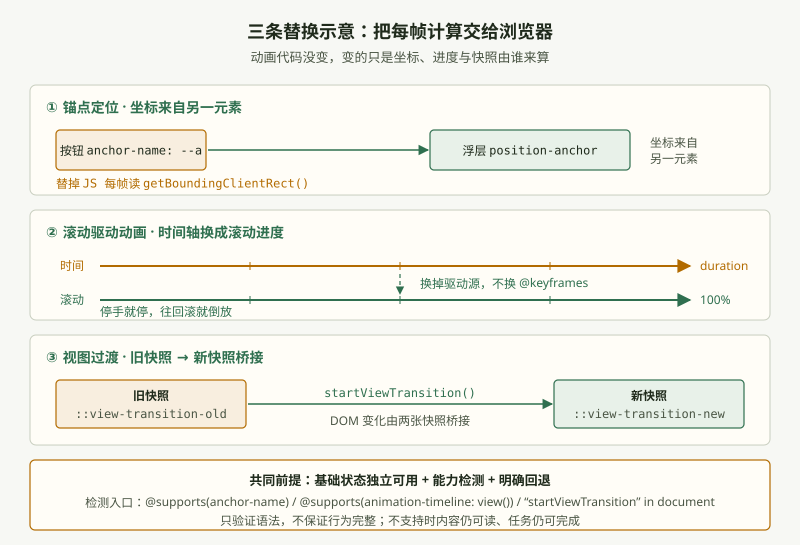

# 26 · 现代平台特性：把每帧计算交给浏览器

> **前置**：[14 · animation](14-animation.md)——时间轴与 fill-mode；[17](17-overflow-scroll.md)——滚动容器；[23](23-accessibility.md)——@supports 模型。
>
> 上一篇：[25](25-tables-lists.md) ｜ 下一篇：[打印与分页媒体](27-print.md) ｜ [教程总览](README.md)

滚动进度条、列表进场、页面切换转场——过去要 JS 逐帧算的活，现代平台正收编为 CSS 原生能力。这一章讲四种新武器的**参数细节与边界**：滚动驱动动画的两种轴与区间、视图过渡的重名规则、原生弹层、锚点定位，统一用 @supports 安全启用。

## 共同思想



*图 26-1 · 滚动驱动动画、视图过渡、原生弹层——各自替代一类 JS 逐帧计算*

**这张图的一句话结论：凡是"每帧按某个输入（滚动/状态）插值"的活，都值得交给浏览器**——更快（合成器线程）、更省（无逐帧开销）、更稳（降级平台统一处理）。

## 滚动驱动动画：两种轴与区间

传统动画的轴是"秒"，滚动驱动把轴换成"滚动进度"。两种轴，参数都要认识：

```css
@supports (animation-timeline: scroll()) {
  .progress {                                   /* 轴 1：scroll() —— 页面/容器滚到哪 */
    animation: grow linear both;
    animation-timeline: scroll(root block);     /* scroller: root/nearest/self */
  }                                             /* axis: block/inline/x/y */
  .photo {                                      /* 轴 2：view() —— 元素自己穿过视口的进度 */
    animation: fade linear both;
    animation-timeline: view(block);
    animation-range: entry 0% cover 50%;        /* 区间：entry/exit/cover/contain + 百分比 */
  }
}
```

- **`scroll()`**：进度条（`root block`）、横向轨道（`nearest inline`）。滚动容器必须真的可滚，否则时间轴恒为 0——"动画不动"先查容器 overflow。
- **`view()`**：列表项进场（`entry`）、离场（`exit`）、全程（`cover`）；`animation-range` 圈定有效区间，避免"滚出屏幕还在动"。
- 兼容姿势：基线是**静态样式**，@supports 内启用增强——不支持时页面功能完整（第 23 篇模型）。

## 视图过渡：重名即失效

```css
::view-transition-old(root) { animation: fade-out .2s both; }
::view-transition-new(root) { animation: fade-in  .2s both; }
```

JS 一行 `document.startViewTransition(() => updateDOM())`，浏览器切换前后各截快照，由伪元素补间。共享元素转场给元素命名 `view-transition-name: hero`，新旧页面同名元素自动衔接飞入。

**硬规则：同一时刻同一文档里 `view-transition-name` 必须唯一**——两个元素重名，转场直接跳过（控制台报错）。列表型共享元素要给每项唯一名（如 `name: card-42`），不能整列同名。

## 原生弹层与入场样式

- **Popover API**：`<div popover>` + `popovertarget` 按钮，浏览器接管显隐与**top layer 层级**（不受 overflow 裁剪、不参与 z-index 比拼，第 08 篇之外的第四态）。`popover="auto"`（点外部关闭，自动互斥）与 `"manual"`（手动控制）两种；样式入口 `::backdrop`。
- **`@starting-style` + `allow-discrete`**：补齐 display 入场动画的第一帧（第 13 篇可插值边界的答案）：

  ```css
  .toast { transition: opacity .3s, transform .3s, display .3s allow-discrete; }
  @starting-style { .toast { opacity: 0; transform: translateY(12px); } }
  ```

- **锚点定位（Anchor Positioning）**：`position-anchor: --tip` + `inset-block-start: anchor(bottom)` 让浮层自动"长在"锚点旁，翻滚/翻转由 `position-area` 表达——tooltip 与下拉的定位难题下沉到 CSS。发布较新，`@supports (anchor-name: --x)` 探测后启用。

## 常见问题

**问题 1：滚动驱动动画完全不动**
- **原因**：滚动容器不可滚（内容没溢出）；或 `scroll()` 指错了 scroller；或不支持却没垫底。
- **修法**：确认容器 `overflow` 有溢出可滚；@supports 包裹 + 基线静态样式；timeline 名义与容器对应。

**问题 2：`view()` 动画提前/滞后**
- **原因**：默认全程 `cover` 区间，元素刚进视口就开始动、出屏还在动。
- **修法**：`animation-range` 圈区间（如 `entry 0% cover 40%`），精确控制起止。

**问题 3：视图转场突然不播了**
- **原因**：`view-transition-name` 重复（本节硬规则）；或 JS 更新回调抛错。
- **修法**：给动态元素加唯一名（数据 id 后缀）；回调里 try/catch 保证 DOM 更新完成。

**问题 4：`::backdrop` 样式怎么改都不生效**
- **原因**：`::backdrop` 是独立伪元素，**不继承宿主样式、不能选其内部**，可继承属性也有限。
- **修法**：backdrop 样式独立完整书写（颜色、backdrop-filter 直接写）；需要联动内容时用变量显式传递。

**问题 5：popover 里的表单提交后弹层不关**
- **原因**：popover 是独立交互元素，不随 form 提交自动关闭。
- **修法**：提交逻辑里显式 `hidePopover()`；`popover="auto"` 只管"点外部关闭"。

## 动手验证

[打开实验台：滚动驱动的进度条与视差](../../examples/modern/scroll-driven-animation.html)

<iframe class="demo-frame" src="/css-concept-course/examples/modern/scroll-driven-animation.html" title="滚动驱动实验" loading="lazy"></iframe>

[打开实验台：视图过渡与原生弹层](../../examples/modern/view-transition.html)

滚动实验台调 `animation-range` 看区间截取；视图过渡实验台里给两个卡片起重名，复现"转场静默跳过"。

## 本章要点

- 共同思想：**每帧按输入插值的活交给浏览器**；统一用 @supports 垫底启用。
- `scroll()` 参数（scroller + 轴）与 `view()` 的 `animation-range` 区间是精确控制的两把钥匙。
- 视图过渡硬规则：**view-transition-name 全文档唯一**，重名即静默失效。
- Popover 进 top layer；`::backdrop` 不继承、不可选内部，样式独立写。
- `@starting-style` + `allow-discrete` 补齐 display 入场动画；锚点定位用 @supports 探测。

下一篇 [27 · 打印与分页媒体](27-print.md)：无限画布变有限纸张。
