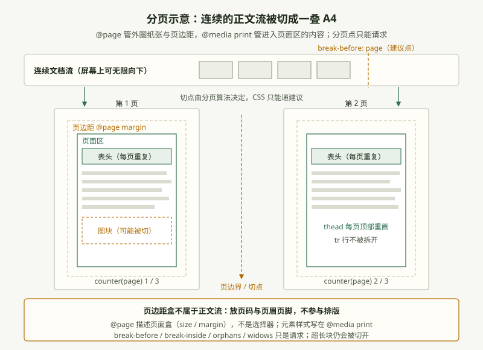

# 27 · 打印与分页媒体

> **前置**：[05](05-units.md)——物理单位；[17](17-overflow-scroll.md)——溢出；[26](26-modern-platform.md) 可后读。
>
> 上一篇：[26](26-modern-platform.md) ｜ 下一篇：[多列、形状与混合](28-shapes-multicol.md) ｜ [教程总览](README.md)

```css
@media print {
  nav, .ad, .comment-box { display: none; }
}
```

打印是屏幕样式的"另一套平台"：**无限画布变有限纸张**，滚动变分页，hover 失去意义。这一章讲全打印骨架：`@media print` 的分工、`@page` 页面上下文、分页点控制、打印专属配方，以及**不用真的打一张纸**的调试方法。

## 两种媒体，两套思路

| | 屏幕 | 打印 |
| --- | --- | --- |
| 画布 | 无限长（滚动） | **有限页**（A4 固定宽高） |
| 导航 | 菜单、滚动 | 目录、页码 |
| 交互 | hover/focus | 无意义——**别让内容藏在交互态里** |
| 单位 | px/rem | `cm`/`mm`/`in`/`pt`（物理单位的主场） |

核心差异一句话：**屏幕能永远往下滚，纸必须在某处断开**——分页是打印样式的全部难点。

## @media print：收窄、去装饰、保语义

```css
@media print {
  nav, aside, .comments, video { display: none; }    /* 屏幕专属部件收走 */
  body { color: #000; background: #fff; font-size: 11pt; }
  a { color: #000; text-decoration: none; }
  main { max-width: none; }                           /* 别让 720px 居中栏浪费纸 */
  .tab-panel:not(.active) { display: block; }         /* Tab 内容全展开（视产品而定） */
}
```

三条经验：隐藏导航与广告、恢复黑白高对比（省墨且清楚）、放宽布局宽度。**深色主题站必须在 print 里强制回亮色**——黑底打印是灾难兼费墨。交互态内容（Tab、折叠、hover 显隐）打印前要展开或明确接受缺失。

## @page：纸本身也是可以 styled 的

```css
@page { size: A4; margin: 2cm; }
@page :first { margin-top: 4cm; }   /* 首页单独设边距 */
```

`@page` 管"纸"：尺寸、页边距（可按 `:first`/`:left`/`:right` 分页设）。正文宽度自动 = 纸宽 − 2×margin——**打印版的"视口"就是这张纸**。

## 分页点：只能请求，不能保证



*图 27-1 · 连续内容被按页切分，分页点用 break-* 请求*

**这张图的一句话结论：分页点只能"请求"不能"保证"——内容必须先能在任意位置断开。**

| 属性 | 作用 | 典型值 |
| --- | --- | --- |
| `break-inside: avoid` | 盒子内部不许断页 | 卡片、figure、表格行 |
| `break-before/after: page` | 前后强制翻页 | 新章节标题 |
| `orphans: 2` / `widows: 2` | 段首/段尾至少留几行 | 默认 2 |

权衡：`avoid` 是请求不是命令——盒子比一页高时必然断（长表格别整表 avoid，按行 avoid）；而 avoid 用得太广会产生**大片空白**（某卡片装不下就整块翻页，留白半页）。高频断点区（正文段落）别加 avoid，只有"视觉原子"（图表、卡片）才需要。

## 打印专属配方

```css
/* ① 链接显示真实地址（第 02 篇 attr() 的经典应用） */
@media print {
  a[href^="http"]::after { content: " (" attr(href) ")"; font-size: 9pt; }
}
/* ② 强制打印背景色（浏览器默认不印背景，省墨） */
.coupon { print-color-adjust: exact; }
```

`print-color-adjust: exact` 只给"颜色即语义"的元素（票券、色卡、图表），全局开启等于跟省墨机制作对。

## 调试：不浪费一张纸

Chrome DevTools → **Rendering → Emulate CSS media type: print**：页面立刻按打印媒体渲染，布局、断页、隐藏全部就地验证；配合 Ctrl/Cmd+P 的预览看最终分页。打印样式上线前的完整流程：模拟检查 → 预览分页 → 真打一页抽查。

## 常见问题

**问题 1：打印出来背景全是白的**
- **原因**：浏览器默认不打印背景（省墨）。
- **修法**：必要元素 `print-color-adjust: exact`；整体黑白化（本章 @media print 配方）而不是硬印背景。

**问题 2：预览分页与实际打印不一致**
- **原因**：页眉页脚/页边距由浏览器打印设置叠加，`@page` 管不了浏览器的 UI 区。
- **修法**：把 @page margin 留出余量；关键内容不贴页边；给用户"打印说明"（关页眉页脚）。

**问题 3：avoid 用多了，每页下半都是空白**
- **原因**：视觉原子太"大"，装不下就整块翻页。
- **修法**：缩小 avoid 范围（按行/按 figure，不按整卡片组）；正文段落开放断页。

**问题 4：深色模式网站打印出来一片黑**
- **原因**：打印媒体仍命中 `prefers-color-scheme: dark`。
- **修法**：`@media print` 里显式回亮色令牌（覆盖主题变量，第 15 篇）。

## 动手验证

[打开 demo：打印预览实测](../../examples/minimal/28-print.html)

<iframe class="demo-frame" src="/css-concept-course/examples/minimal/28-print.html" title="打印实验" loading="lazy"></iframe>

[打开实验台：分页布局综合玩法](../../examples/engineering/print-layout.html)

开 DevTools 的 print 模拟对照 `break-inside: avoid` 生效与否；实验台调 @page 边距看正文宽度跟着纸走。

## 本章要点

- 打印 = 有限纸页：`@media print` 收窄去装饰保语义、强制回亮色；`@page` 管纸张与页边距。
- 分页点 `break-*` 只能请求；avoid 只给视觉原子，滥用产生大空白。
- 交互态内容打印前展开或明确接受缺失。
- 配方两件：链接 `attr(href)` 显示地址、`print-color-adjust: exact` 定点强印背景。
- 调试走 DevTools print 模拟 → 预览 → 真打抽查，不浪费纸。

下一篇 [28 · 多列、形状与混合](28-shapes-multicol.md)：四个属性族管四个对象。
