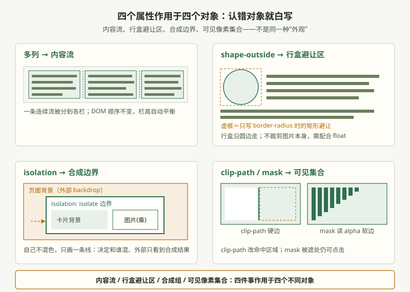

# 28 · 多列、形状与混合：四个属性族管四个对象

> **前置**：[06](06-colors-backgrounds.md)——背景分层与阴影；[17](17-overflow-scroll.md)——溢出；[18](18-stacking-context.md)——层叠上下文。
>
> 上一篇：[27](27-print.md) ｜ 下一篇：无（全书完） ｜ [教程总览](README.md)

```css
.article { columns: 3; }
```

一行变三栏——但"文字流进哪一栏、图片绕不绕、颜色怎么叠"是三件互不相干的事，分属四个属性族：**多列管内容流、形状管行盒避让、混合管合成、滤镜管像素**。认错对象就白写。这一章把四族讲清边界（含 `column-fill`、mask 全家），全书知识地图在此收口。

## 多列：内容像水一样流进分栏

```css
.article {
  columns: 3 16rem;        /* 期望 3 栏，每栏至少 16rem，不够自动减栏 */
  column-gap: 2rem;
  column-rule: 1px solid var(--line);
}
.article figure { break-inside: avoid; }   /* 图别被劈到两栏 */
.article h2 { column-span: all; }          /* 标题横跨所有栏 */
.article { column-fill: balance; }         /* balance(默认，均衡) / auto(顺序填满) */
```

心智模型：多列是**内容流**排版（报纸模式）——横向填满一栏再流下一栏。`column-fill` 的两个值对应两种诉求：`balance`（默认）尽量让各栏等高；**容器定高时 `auto` 才会"顺序填满第一栏再下一栏"**——"定高了高度却各栏都矮半截"的谜题答案就在这。断栏控制（`break-*`）与打印分页（第 27 篇）是同一族属性，规则互通。多列与 Flex/Grid 的本质区别：**Grid 管盒子摆放，多列管文字流动**。



*图 28-1 · 多列→内容流、形状→行盒、混合→合成、滤镜→像素*

**这张图的一句话结论：先问"我要作用在什么对象上"，再选属性族。**

## 形状：行盒绕开图形

```css
.leaf {
  float: left;
  width: 120px; height: 120px;
  shape-outside: circle(50%);   /* 文字沿圆边绕排——只对浮动元素生效 */
  clip-path: circle(50%);       /* 视觉裁成圆，两者常配对 */
}
```

`shape-outside` 改**文字的排列**、`clip-path` 改**图形的裁剪**——只写前者会出现"文字绕圆、图还是方的"。clip-path 独立也好用：`circle()/ellipse()/polygon()`；同为 polygon 且**点数相同**时可过渡（第 13 篇可插值原则），做形状渐变动画。mask 系列是它的进阶兄弟：

```css
.fade { mask-image: linear-gradient(#000 60%, transparent); }  /* 渐隐遮罩 */
.icon { mask: url(icon.svg) center / contain no-repeat; }       /* 用 SVG 形状抠图 */
```

mask 用"亮度/透明度"决定保留区域（与 background 分层语法同构：image/position/size/repeat/composite），渐隐边缘、异形卡片的正统做法。

## 混合与滤镜：像素层加工

```css
.overlay { mix-blend-mode: multiply; }     /* 元素与"背后已画好的内容"混合 */
.group   { isolation: isolate; }           /* 圈定混合范围（第 18 篇） */
.photo   { filter: grayscale(1) contrast(1.1); }
.glass   { backdrop-filter: blur(8px); }   /* 毛玻璃：模糊"背后"内容 */
.logo    { filter: drop-shadow(0 2px 4px rgb(0 0 0 / .3)); }
```

- `mix-blend-mode` 在**同一层叠上下文**内与背后内容混合——范围由 `isolation` 圈定（第 18 篇模型再兑现）；`background-blend-mode` 是多层背景之间的专用版。
- `filter` 加工元素自身绘制；`backdrop-filter` 加工它背后（毛玻璃，绘制成本高，第 21 篇）。
- **`drop-shadow` 跟随透明轮廓**（异形 PNG、镂空 SVG），`box-shadow` 永远画矩形盒影——异形元素用错会出现"方影子"。
- filter 同时创建层叠上下文与包含块（第 09/18 篇例外名单的老熟人）。

## 常见问题

**问题 1：多列容器定高后，每栏都只有半截内容**
- **原因**：`column-fill` 默认 `balance` 在定高时按"均衡"切分，内容不满整栏也平摊。
- **修法**：定高场景改 `column-fill: auto`，顺序填满第一栏再下一栏。

**问题 2：shape-outside 写了没反应**
- **原因**：它只对**浮动元素**生效（绕排的是 float 旁边的行盒）。
- **修法**：先 `float: left/right`；形状值与实际图片对齐（circle 中心/半径要算）。

**问题 3：混合模式"跟错对象"**
- **原因**：混合发生在同一层叠上下文内，祖先有 opacity/transform 时范围被圈窄或圈错。
- **修法**：用 `isolation: isolate` 显式声明混合边界（第 18 篇）。

**问题 4：毛玻璃后面是黑的/没效果**
- **原因**：backdrop-filter 模糊的是"背后已绘制内容"，背后没有内容（父级纯色）自然看不出；父级 overflow 裁剪也可能截断。
- **修法**：背后放真实内容或半透明底；确认没有中间层裁剪。

**问题 5：drop-shadow 在镂空图上画出方影子**
- **原因**：用成了 `box-shadow`（永远矩形盒影）。
- **修法**：异形轮廓用 `filter: drop-shadow()`。

**问题 6：mask 图标整个消失**
- **原因**：mask 语法多层组合时漏写 size/position，或 SVG 没有实色填充（mask 按亮度/透明度取值）。
- **修法**：用简写 `mask: url(...) center / contain no-repeat`；确认 SVG 是不透明形状。

## 动手验证

[打开 demo：四族属性逐一对照](../../examples/minimal/29-shapes-mix.html)

<iframe class="demo-frame" src="/css-concept-course/examples/minimal/29-shapes-mix.html" title="多列与混合实验" loading="lazy"></iframe>

[打开实验台：多列与形状绕排](../../examples/visual/shape-multicol.html)

[打开实验台：滤镜与遮罩进阶](../../examples/visual/filters-masks-clip.html)

多列实验台定高后切 `column-fill` 两值（问题 1 现场）；滤镜实验台对比 `box-shadow` 与 `drop-shadow` 在镂空图形上的"方影/贴形"。

## 本章要点

- 四个对象四族属性：**内容流→多列、行盒→shape-outside、合成→混合、像素→filter**。
- 定高多列用 `column-fill: auto` 顺序填满；balance 是均衡切分。
- shape-outside 依赖 float；mask 与 background 分层语法同构，渐隐边缘的正统做法。
- 混合范围由 `isolation: isolate` 圈定；drop-shadow 跟随透明轮廓，box-shadow 永远矩形。
- backdrop-filter 要"背后有内容"才有意义，且绘制成本高（第 21 篇）。

**全书完。** 28 章覆盖 CSS 从书写、盒模型、布局、动效到底层机制与平台能力的完整知识地图；复习任意知识点请回 [教程总览](README.md)。
